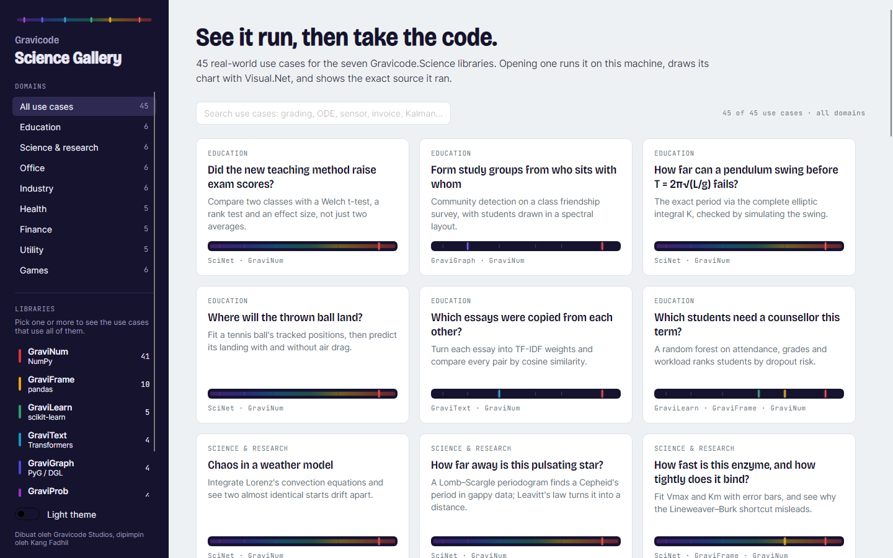
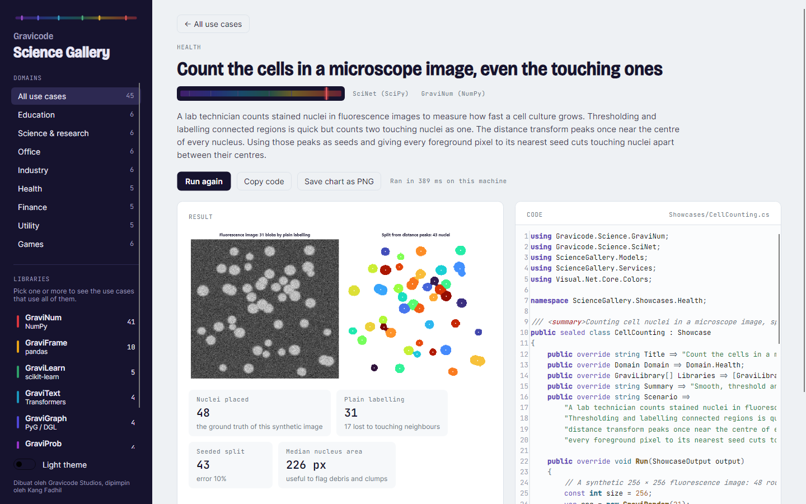
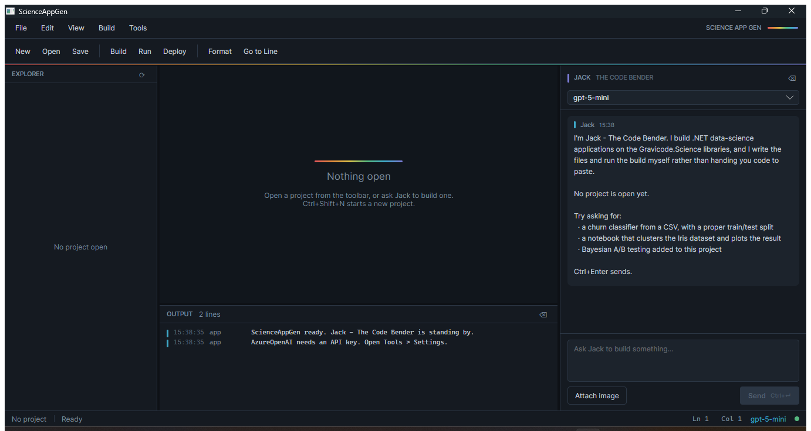
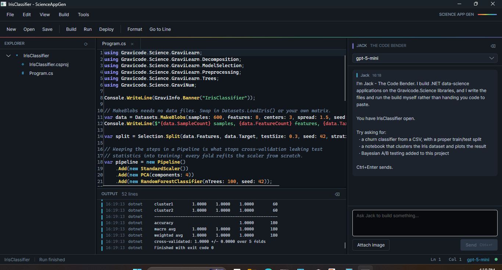

?# Gravicode.Science

A data science and AI ecosystem for **.NET 10** — seven libraries that mirror the Python stack,
each with a runnable sample, an interactive notebook, benchmarks and tests.

[](https://dotnet.microsoft.com)
[](tests)
[](LICENSE)
[](https://www.nuget.org/packages?q=Gravicode.Science)

Published from
[DotNetVibeCoderz/Vibe_ML](https://github.com/DotNetVibeCoderz/Vibe_ML/tree/main/GravicodeScience).

| Library | Python analogue | Focus |
|---|---|---|
| [**GraviNum**](docs/GraviNum.md) | NumPy + autograd | N-dimensional arrays, linear algebra, autodiff, FFT, random, statistics |
| [**GraviFrame**](docs/GraviFrame.md) | pandas | DataFrames, group-by, pivot, joins, time series |
| [**GraviLearn**](docs/GraviLearn.md) | scikit-learn | Preprocessing, supervised & unsupervised ML, pipelines, metrics |
| [**GraviText**](docs/GraviText.md) | HuggingFace Transformers | Tokenization, embeddings, transformers, NLP tasks |
| [**GraviGraph**](docs/GraviGraph.md) | PyTorch Geometric / DGL | Graph structures, embeddings, GNNs |
| [**GraviProb**](docs/GraviProb.md) | PyMC / Stan | Distributions, MCMC and NUTS, variational inference, probabilistic models |
| [**SciNet**](docs/SciNet.md) | SciPy | Special functions, optimisation, ODEs, interpolation, statistics, signal, FFT, sparse, spatial, ndimage, scientific file formats |

## Install

```bash
dotnet add package Gravicode.Science.GraviNum      # arrays, linear algebra, autodiff
dotnet add package Gravicode.Science.GraviFrame    # dataframes
dotnet add package Gravicode.Science.GraviLearn    # machine learning
dotnet add package Gravicode.Science.GraviText     # NLP
dotnet add package Gravicode.Science.GraviGraph    # graphs and GNNs
dotnet add package Gravicode.Science.GraviProb     # Bayesian inference
dotnet add package Gravicode.Science.SciNet        # SciPy for .NET
```

Take only what you need — every package pulls in `GraviNum`, and nothing else is mandatory. See
[docs/publishing.md](docs/publishing.md) for how a release is cut.

## Quick start

```bash
git clone https://github.com/DotNetVibeCoderz/Vibe_ML.git
cd Vibe_ML/GravicodeScience
dotnet build Gravicode.Science.sln -c Release
dotnet test

dotnet run --project samples/GraviLearn.Console
```

```csharp
using Gravicode.Science.GraviLearn;
using Gravicode.Science.GraviLearn.Decomposition;
using Gravicode.Science.GraviLearn.ModelSelection;
using Gravicode.Science.GraviLearn.Preprocessing;
using Gravicode.Science.GraviLearn.Trees;

var iris = Datasets.LoadIris();
var split = Selection.Split(iris.Features, iris.Target, testSize: 0.3, stratify: true);

var pipeline = new Pipeline()
    .Add(new StandardScaler())
    .Add(new PCA(components: 3))
    .Add(new RandomForestClassifier(nTrees: 100));

pipeline.Fit(split.TrainX, split.TrainY);
Console.WriteLine(Metrics.ClassificationReport(split.TestY, pipeline.Predict(split.TestX), iris.LabelNames));
```

## What is in the box

```
src/          seven class libraries
samples/      seven console apps, each printing real results
notebooks/    seven .NET Interactive notebooks with charts
benchmarks/   seven BenchmarkDotNet suites, plus the Python comparison harness
datasets/     Iris, Titanic, MNIST digits, Cora, plus generated data
tests/        3,257 tests
tools/        ScienceAppGen (an IDE that builds apps from a prompt), Science Gallery
              (45 runnable use cases), the icon generator
assets/       NuGet package icons
docs/         English, with Bahasa Indonesia in docs/id/
```

## Gravicode Science Gallery

[](docs/ScienceGallery.md)

A desktop app with **45 real-world use cases** across education, science and research, office
work, industry, health, finance, utilities and games. Opening one runs it on your machine, draws its
chart with [Visual.Net](https://github.com/DotNetVibeCoderz/Vibe_Charting/tree/main/Visual.Net), and
shows the exact source file it ran — copy it and you have working code.

```bash
dotnet run --project tools/ScienceGallery
```

Filter by domain or by the libraries a use case uses; each card's spectrum strip lights the
libraries it needs, in the same emission-line colours as the NuGet icons.

[](docs/ScienceGallery.md)

The charts come from the Visual.Net packages on NuGet (`Gravicode.Matplotlib.Net`,
`Gravicode.Seaborn.Net`). Details in [ScienceGallery.md](docs/ScienceGallery.md).

## ScienceAppGen

[](docs/ScienceAppGen.md)

A desktop IDE with an assistant that **writes the files and runs the build itself** rather than
printing code for you to copy.

```bash
dotnet run --project tools/ScienceAppGen
```

Editor with syntax highlighting and a file explorer, ten data-science project templates, and a chat
panel backed by Semantic Kernel with 16 kernel functions — project and file operations, build and
run, web search, scraping, exact arithmetic, the clock, and a curated Gravicode API reference.

Works with **OpenAI, Azure OpenAI, Anthropic, Google and Ollama**. Claude is served by a
hand-written chat completion service, because Semantic Kernel has no official Anthropic connector.

Verified end to end against a live endpoint: from one prompt it created a project, wrote the code
and built it — and the test harness independently rebuilt and ran the result to confirm the output.
The template path was driven through the UI separately; here is `ml-pipeline` generated, built and
run without a line typed in between.

[](docs/ScienceAppGen.md#a-template-start-to-finish)

Details in [ScienceAppGen.md](docs/ScienceAppGen.md).

## SciNet — SciPy for .NET


[SciNet](docs/SciNet.md) covers every `scipy.*` module — special functions, constants, optimize,
integrate, interpolate, linalg, differentiate, fft, signal, stats, ndimage, cluster, sparse
(with `sparse.linalg` and `csgraph`), spatial and io — on top of GraviNum, with 2,198 tests pinned
against SciPy 1.17.1 values.

```csharp
using Gravicode.Science.SciNet;

void Lorenz(double t, ReadOnlySpan<double> y, Span<double> dy)
{
    dy[0] = 10 * (y[1] - y[0]);
    dy[1] = y[0] * (28 - y[2]) - y[1];
    dy[2] = y[0] * y[1] - 8.0 / 3.0 * y[2];
}

var orbit = Integrate.SolveIvp(Lorenz, 0, 100, [1.0, 1.0, 1.0], OdeMethod.Rk45, rtol: 1e-9, atol: 1e-9);
var best = Optimize.Minimize(Optimize.Rosen, [1.3, 0.7, 0.8, 1.9, 1.2], MinimizeMethod.Bfgs, jac: Optimize.RosenDer);
var lowpass = Signal.Butter(4, 20.0, FilterType.Lowpass, fs: 1000);
var test = Stats.TtestInd(a, b, equalVar: false);
```

In many places it reproduces SciPy's *path*, not just its answer: `quad` returns SciPy's
evaluation count, `solve_ivp` takes SciPy's step sequence, BFGS and L-BFGS-B take SciPy's
iterations, and `linkage` produces SciPy's matrix exactly. It is fastest wherever SciPy calls back
into Python — the Lorenz system above takes 5.5 ms against SciPy's 1,004 ms. Across 26 measured
workloads it is faster on 21, including sparse LU (2.3×, a multifrontal factorisation) and `expm`;
SciPy still leads on `curve_fit`, a single `lfilter` and the DCT. The numbers are in
[docs/SciNet.md](docs/SciNet.md#performance-against-scipy).

## Design

**`GraviNum` is the foundation.** Every other library builds on its array and linear-algebra
layer, and nothing above it is ever referenced back down.

```
GraviNum ──┬── GraviFrame ── GraviLearn ── GraviText ── GraviGraph
           ├── GraviProb
           └── SciNet
```

**Views, not copies.** Reshaping, transposing and slicing an `NdArray` produce views over one
shared buffer. Only `Copy()` moves data.

**Three-tier dispatch.** Element-wise work automatically picks a `Vector<double>` SIMD loop, a
threaded version of it, or a strided broadcast walk, based on shape and size. Callers never choose.

**Honest performance.** `LinAlg.Dot` sustains ~24 GFLOP/s at 512×512 on a mid-range laptop CPU,
about 20× the textbook triple loop. GPU support exists through ILGPU but is **opt-in**: everything
here is float64, and on integrated hardware the GPU measured 5–8× *slower*. See
[benchmarks.md](docs/benchmarks.md).

## How it compares to NumPy, pandas and scikit-learn

Measured with an identical harness on both sides — same shapes, same fixtures, same warmup and
repeat protocol. Full tables in [benchmarks.md](docs/benchmarks.md#against-the-python-stack).

| Where the work is… | Winner | Examples |
|---|---|---|
| A **LAPACK/BLAS call** in disguise | **Python**, 3–15× | SVD 11×, symmetric eigen 5.6×, PCA 11×, matmul 3–6× |
| Compiled Cython inner loops | Python, 2–11× | pandas group-by 6.8×, kNN 11×, k-means 5× |
| **Scalar, branchy or sequential** | **.NET**, 2–132× | scalar log-density 132×, BFS 40×, MCMC 13×, Dijkstra 5.6× |
| **Bound by memory bandwidth** | **.NET**, 1.8× | element-wise add, 1M and 10M elements |
| A better **algorithm** | .NET | rolling mean 8.6× (incremental accumulator vs recompute) |
| Tree building | .NET 1.4× | random forest fit beats scikit-learn |

Tally: .NET faster on 12 measurements, Python faster on 22, parity on 3.

The first row used to read *5–140×*. Two v0.2 changes moved it:

- **Decompositions.** SVD and symmetric eigen used Jacobi methods, which sweep the entire matrix
  until it stops changing. Householder reduction plus a shifted QR/QL iteration made symmetric
  eigen **23.6× faster** and SVD **5.5× faster**, taking the worst gaps from 139× and 66× down to
  5.6× and 11×.
- **Element-wise arithmetic.** The parallel path was copying both operands and the result — three
  extra passes over memory to satisfy a lambda capture. Removing them made it **3× faster** and
  put it *ahead* of NumPy.

The split is not random. Wherever an operation bottoms out in decades-tuned Fortran, Python wins,
and wherever the work is a tight scalar loop that cannot be vectorised into one library call, a
JIT-compiled language wins outright — that is most of graph analytics, sampling and text processing.

**Those figures are the managed path.** If the machine has OpenBLAS or MKL, `NativeBlas` and
`NativeLapack` find it and the first row changes completely: matmul reaches **parity with NumPy**
and QR goes from 15× behind to 1.3×. Nothing native is bundled, and nothing breaks without it. Both
configurations are reported in [benchmarks.md](docs/benchmarks.md#does-a-native-blas-change-these-numbers).

> The comparison paid for itself immediately: it exposed an **O(n²) decision-tree split** that made
> the random-forest benchmark run for 83 minutes without finishing. Fixed, it fits in 1.9 s — and
> now beats scikit-learn. It also caught a benchmark that the JIT had optimised into nothing.

## Verified against reference implementations

The test suite pins results that are independently known, so a regression shows up as a test
failure rather than as a plausible-looking number:

| | Result |
|---|---|
| PCA on Iris | 92.46% / 5.31% variance on the first two components |
| Digits, `StandardScaler → PCA(30) → kNN(3)` | 97.96% test accuracy |
| Cora largest weakly connected component | 2,485 of 2,708 nodes |
| Coin-flip posterior, MCMC vs exact conjugate | agrees to ~0.002 |
| Titanic random forest | above the 0.78 published baseline |

## Documentation

| | English | Bahasa Indonesia |
|---|---|---|
| Installation | [installation.md](docs/installation.md) | [id/installation.md](docs/id/installation.md) |
| Getting started | [getting_started.md](docs/getting_started.md) | [id/getting_started.md](docs/id/getting_started.md) |
| Benchmarks | [benchmarks.md](docs/benchmarks.md) | [id/benchmarks.md](docs/id/benchmarks.md) |
| Datasets | [datasets.md](docs/datasets.md) | [id/datasets.md](docs/id/datasets.md) |
| ScienceAppGen | [ScienceAppGen.md](docs/ScienceAppGen.md) | [id/ScienceAppGen.md](docs/id/ScienceAppGen.md) |
| Publishing and CI | [publishing.md](docs/publishing.md) | [id/publishing.md](docs/id/publishing.md) |
| SciNet (SciPy for .NET) | [SciNet.md](docs/SciNet.md) | [id/SciNet.md](docs/id/SciNet.md) |
| Science Gallery | [ScienceGallery.md](docs/ScienceGallery.md) | [id/ScienceGallery.md](docs/id/ScienceGallery.md) |
| Package icons | [assets/icons/README.md](assets/icons/README.md) | |

Per-library guides sit alongside them in [`docs/`](docs) and [`docs/id/`](docs/id).

Roadmap: [PLAN.md](PLAN.md) · Status: [Progress.md](Progress.md)

## Samples

Each prints a hardware report, then does real work on real data:

```bash
dotnet run --project samples/GraviNum.Console     # matrix ops, decompositions, GFLOP/s
dotnet run --project samples/GraviFrame.Console   # Titanic: group-by, pivot, joins, time series
dotnet run --project samples/GraviLearn.Console   # Iris: forests, cross-validation, grid search
dotnet run --project samples/GraviText.Console    # bilingual sentiment, embeddings, transformer
dotnet run --project samples/GraviGraph.Console   # Cora: PageRank, centrality, GCN
dotnet run --project samples/GraviProb.Console    # Bayesian coin toss, HMM, Bayesian network
dotnet run --project samples/SciNet.Console       # ODEs, optimisation, filters, statistics, file formats
```

They also render the charts in [`docs/screenshots/`](docs/screenshots).

## Requirements

.NET SDK 10.0 or later. Windows, Linux or macOS. A GPU is optional and never required.

## Licence

MIT.

---

*Dibuat oleh Gravicode Studios, dipimpin oleh Kang Fadhil*

