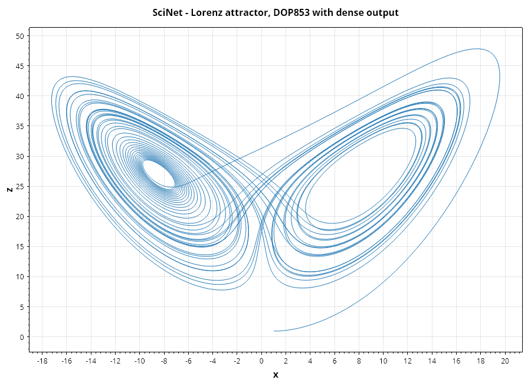
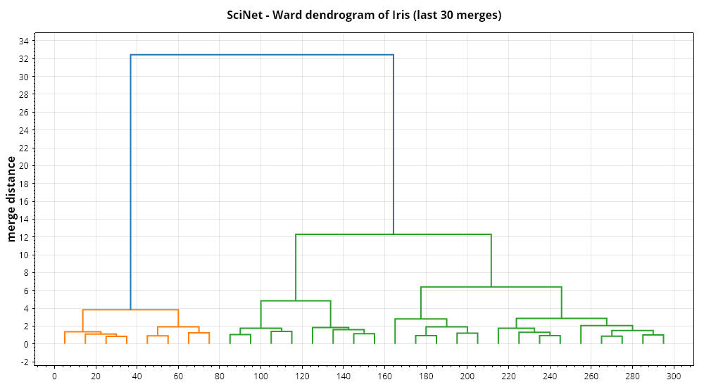
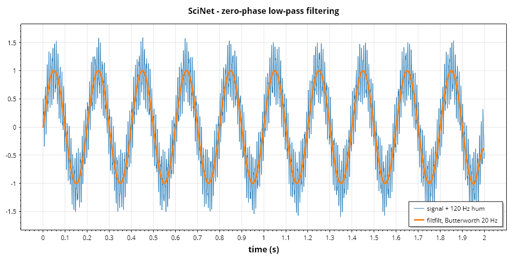
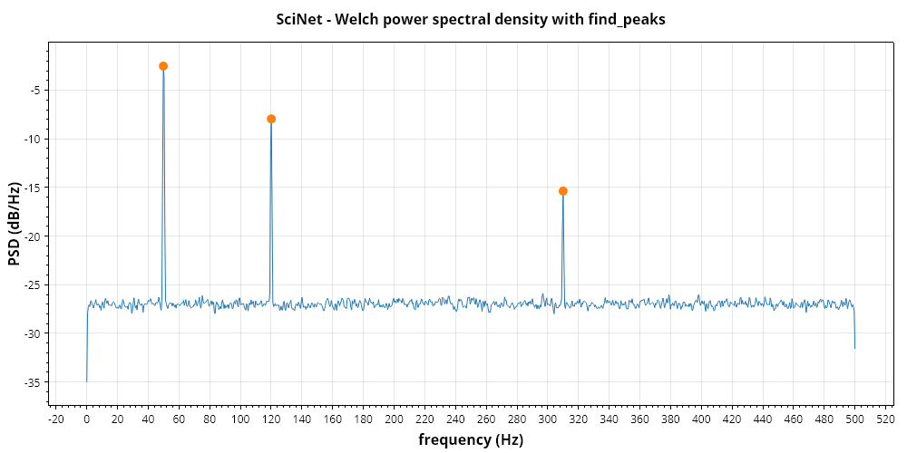

# SciNet

*[Bahasa Indonesia](id/SciNet.md)* · SciPy for .NET — special functions, optimisation,
integration and ODEs, interpolation, linear algebra, sparse matrices and graphs, spatial
algorithms, clustering, signal processing, FFT, image processing, statistics, physical constants
and scientific file formats.

SciNet builds on GraviNum only. Arrays are GraviNum `NdArray`s, 1-D vectors are `double[]`, and
every callback is a .NET delegate — which is where most of SciNet's speed comes from: SciPy calls
back into Python for every function evaluation, SciNet does not.

| SciPy module | SciNet entry point | Namespace |
|---|---|---|
| `scipy.special` | `Special` | `Gravicode.Science.SciNet` |
| `scipy.constants` | `Constants` | `Gravicode.Science.SciNet` |
| `scipy.optimize` | `Optimize` | `Gravicode.Science.SciNet` |
| `scipy.integrate` | `Integrate` | `Gravicode.Science.SciNet` |
| `scipy.interpolate` | `Interpolate`, `CubicSpline`, `BSpline`, … | `Gravicode.Science.SciNet` |
| `scipy.linalg` | `Linalg` | `Gravicode.Science.SciNet` |
| `scipy.differentiate` | `Differentiate` | `Gravicode.Science.SciNet` |
| `scipy.fft` | `Fft`, `FftPlan`, `RfftPlan` | `Gravicode.Science.SciNet` |
| `scipy.signal` | `Signal` | `Gravicode.Science.SciNet` |
| `scipy.stats` | `Stats` | `Gravicode.Science.SciNet` |
| `scipy.ndimage` | `NdImage` | `Gravicode.Science.SciNet` |
| `scipy.cluster` | `Cluster` | `Gravicode.Science.SciNet` |
| `scipy.sparse`, `.linalg`, `.csgraph` | `CsrMatrix`, `SparseLinalg`, `CsGraph`, … | `Gravicode.Science.SciNet.Sparse` |
| `scipy.spatial` | `KDTree`, `Distance`, `Delaunay`, `Rotation`, … | `Gravicode.Science.SciNet.Spatial` |
| `scipy.io` | `MatFile`, `MatrixMarket`, `WavFile`, … | `Gravicode.Science.SciNet.IO` |

```bash
dotnet add package Gravicode.Science.SciNet
```

> **Two names to watch.** SciNet's `Linalg` (scipy.linalg) and GraviNum's `LinAlg`
> (numpy.linalg) differ only by case, on purpose. And scipy's `fft()` is `Fft.Fft1D()` — C# does
> not allow a method to share its class's name.

## How close to SciPy, and how it was checked

Every module is pinned against values computed with **SciPy 1.17.1**, hard-coded into the tests,
plus closed forms, identities and brute-force references written inside the tests. In many
places SciNet reproduces SciPy *exactly* — not just the answer but the path to it:

- `Integrate.Quad` returns SciPy's value, error estimate **and evaluation count** (QUADPACK is
  ported line by line, error-flag bookkeeping included).
- `Integrate.SolveIvp` takes SciPy's exact step sequence for RK23, RK45, DOP853, Radau and BDF.
- `Optimize.Minimize` with Nelder–Mead, Powell, CG, BFGS, Newton-CG, the trust-region methods and
  L-BFGS-B uses the same number of iterations and function evaluations.
- `Cluster.Linkage` produces SciPy's linkage matrix exactly, ties included, for all seven methods.
- `Interpolate.Splrep` with smoothing is a port of FITPACK's `curfit`: same knots, coefficients
  to ~1e-12.

Where SciNet deliberately differs, the docs below say so.

## Special functions

```csharp
using Gravicode.Science.SciNet;

Special.Gamma(0.5);          Special.GammaLn(1e5);      Special.Digamma(3);
Special.GammaInc(2, 3);      Special.BetaIncInv(2, 3, 0.4);
Special.Erfc(6);             // 2.15e-17, computed directly - not as 1 - Erf(6)
Special.LogNdtr(-40);        // -804.6, where Ndtr underflows
Special.Jv(2.5, 10);  Special.Kv(1, 3);  Special.Airy(1.0);   // Bessel and Airy
Special.EllipK(0.99); Special.EllipJ(0.5, 0.3);                // elliptic
Special.Hyp2f1(1, 2, 3, 0.5);  Special.Zeta(3);  Special.LambertW(1);
Special.Stdtr(df: 5, t: 2.0);  Special.Chdtri(3, 0.05);        // distribution helpers
var rule = Special.RootsLegendre(50);                          // Gauss quadrature nodes and weights
rule.Integrate(Math.Cos);
Special.Erf(array);          // NdArray overloads, parallel above a threshold
```

Families: gamma and beta (with regularised incomplete forms and inverses), error functions and
Faddeeva `Wofz`, Owen's T, Bessel J/Y/I/K of real order with scaled and spherical variants and
zeros, Hankel, Airy, orthogonal polynomials (Legendre, associated Legendre, spherical harmonics
with `sph_harm_y` argument order, Hermite, Laguerre, Chebyshev, Gegenbauer, Jacobi) and their
Gauss rules, hypergeometric 0F1/1F1/2F1, zeta, exponential and sine/cosine integrals, Lambert W,
complete/incomplete elliptic integrals, Jacobi elliptic functions, Carlson forms, and the cephes
distribution functions (`Stdtr`, `Chdtr`, `Fdtr`, `Bdtr`, `Pdtr`, `Nbdtr`, `Gdtr`, `Kolmogorov`,
`Smirnov` with complements and inverses).

**Accuracy.** Typically 1e-15 to 5e-15 relative against SciPy. Where SciPy and mpmath disagree
the tests use mpmath, and SciNet is the more accurate one in several places (Bessel J0/Y0 at
x = 1e5, `Ndtr` and `OwensT` deep in the tail, `LambertW` near the branch point, high-order
Legendre weights, `Hyp2f1` when c − a − b is an integer, where SciPy returns NaN). Weaker spots,
around 1e-13 to 1e-12: `Smirnov` for large n, incomplete-beta tails below 1e-280, Bessel values
right at their zeros. `Hyp2f1` covers real z ≤ 1.

Also: Struve H/L, `Hyperu`, the Kelvin functions, Wright's generalised Bessel function, `Agm`,
degree-argument trigonometry, and the cdflib inverses SciPy exposes — `Gdtrix`/`Gdtria`/`Gdtrib`,
`Stdtridf`, `Bdtrik`, `Pdtrik`, `Nbdtrik`, and the non-central `Chndtr`, `Nctdtr`, `Ncfdtr` with
their inverses. The inverses solve to full precision and return NaN where no parameter reaches
the probability (SciPy returns its search limit, such as −1e100). Not implemented: Mathieu
functions.

## Physical constants

```csharp
Constants.SpeedOfLight;  Constants.Planck;  Constants.Avogadro;  Constants.Kilo;  Constants.Inch;
Constants.Value("electron mass");   Constants.Unit("Planck constant");   Constants.Precision("proton mass");
Constants.Find("Boltzmann");        // matching keys
Constants.ConvertTemperature(98.6, "F", "C");
```

All 445 entries of `scipy.constants.physical_constants` (CODATA 2022), generated from SciPy
1.17.1, plus every module-level unit and prefix name.

## Optimisation

```csharp
var result = Optimize.Minimize(Optimize.Rosen, [1.3, 0.7, 0.8, 1.9, 1.2],
    MinimizeMethod.Bfgs, jac: Optimize.RosenDer);
result.X;  result.Fun;  result.Nit;  result.Nfev;  result.Success;

// bounds and constraints
Optimize.Minimize(f, x0, MinimizeMethod.LBfgsB, bounds: new Bounds([0, 0], [1, 2]));
Optimize.Minimize(f, x0, MinimizeMethod.Slsqp, constraints: [
    new OptimizeConstraint(OptimizeConstraintType.Ineq, x => [x[0] - 2 * x[1] + 2]),
    new OptimizeConstraint(OptimizeConstraintType.Eq, x => [x[0] + x[1] - 1])]);

// scalar problems and roots
Optimize.MinimizeScalar(x => (x - 2) * (x - 2));
Optimize.Brentq(x => Math.Cos(x) - x, 0, 1);
Optimize.Root(F, x0, RootMethod.Hybr);

// fitting
var fit = Optimize.CurveFit((t, p) => p[0] * Math.Exp(-p[1] * t) + p[2], t, y, p0: [1, 1, 1]);
fit.Popt;  fit.Pcov;  fit.Perr;
Optimize.LeastSquares(residuals, x0, loss: LeastSquaresLoss.SoftL1, bounds: bounds);
Optimize.Nnls(A, b);   Optimize.LsqLinear(A, b, bounds);

// linear and integer programming, assignment
Optimize.Linprog(c, aUb: A, bUb: b);
Optimize.Milp(c, integrality, bounds, constraints);
var (rows, cols) = Optimize.LinearSumAssignment(cost);

// global
Optimize.DifferentialEvolution(f, bounds, seed: 7);
Optimize.DualAnnealing(f, bounds);  Optimize.BasinHopping(f, x0);  Optimize.Direct(f, bounds);  Optimize.Brute(f, ranges);
Optimize.Shgo(f, bounds, n: 64, iters: 3, samplingMethod: ShgoSamplingMethod.Sobol);   // all local minima in Xl/Funl

// interior-point / SQP with general constraints
Optimize.Minimize(f, x0, MinimizeMethod.TrustConstr, bounds: bounds,
    constraints: [new LinearConstraint(A, lb, ub), new NonlinearConstraint(g, lb2, ub2)]);

// assignment and isotonic regression
Optimize.QuadraticAssignment(flow, distance);  Optimize.IsotonicRegression(y);
```

Local methods: Nelder–Mead, Powell, CG, BFGS, Newton-CG, L-BFGS-B, TNC, SLSQP, COBYLA,
trust-constr, dogleg, trust-ncg, trust-exact, trust-krylov. The legacy functional interface is
there too (`Fmin`, `FminBfgs`, `FminLBfgsB`, `FminTnc`, `FminSlsqp`, `Leastsq`, `Brent`,
`Fminbound`, `Broyden1`, `NewtonKrylov`, …), returning result objects rather than tuples. Roots: bisect, brentq, brenth, ridder, TOMS 748, Newton /
secant / Halley, fixed point; for systems hybr, lm, Broyden 1/2, Anderson, linear mixing,
diagonal Broyden, excitingmixing, Newton–Krylov, DF-SANE. Least squares: TRF, dogbox and
Levenberg–Marquardt with five robust losses.

`trust-constr` is SciPy's algorithm — Byrd–Omojokun SQP for equality constraints, wrapped in a
barrier method for inequalities and bounds — and follows SciPy's path: equality-only and
bound-only problems take SciPy's iterations to ~1e-12. TNC is a line-by-line port of Nash's
`tnc.c` (bounded Rosenbrock: 39 evaluations, like SciPy). SHGO reproduces SciPy's sampling and
minimiser pool exactly with full simplicial refinement; with Sobol/Halton sampling its
triangulation is its own, so the pool can differ while the best minima agree.

**Not ports, and so with different iteration counts (solutions are tested):** COBYLA
(Powell-style, not PRIMA), SLSQP (Goldfarb–Idnani QP instead of Kraft's LSQ), Newton–Krylov
(GMRES instead of LGMRES), DIRECT. `trust-constr` is dense only. `Linprog` has no presolve; its
interior-point method rebuilds A·D·Aᵀ densely and is slow on large problems — the simplex is the
default.

## Integration and ODEs

```csharp
var q = Integrate.Quad(x => Math.Log(x) / Math.Sqrt(x), 0, 1);       // q.Value, q.AbsErr, q.Neval
Integrate.Quad(x => Math.Exp(-x * x), double.NegativeInfinity, double.PositiveInfinity);
Integrate.Quad(f, 0, 1, weight: QuadWeight.Cos, wvar: 50);           // QAWO
Integrate.Dblquad((y, x) => x * y, 0, 1, x => 0, x => 1 - x);
Integrate.Simpson(y, x);   Integrate.CumulativeTrapezoid(y, x);   Integrate.TanhSinh(f, 0, 1);
Integrate.Cubature(f, [0, 0], [1, 1]);
```

`Quad` covers QAGS, QAGI (infinite ranges), QAGP (break points), QAWO/QAWF (oscillatory weights),
QAWS (algebraic–logarithmic end-point weights) and QAWC (Cauchy principal value).

ODE right-hand sides are an allocation-free delegate:

```csharp
void Lorenz(double t, ReadOnlySpan<double> y, Span<double> dy)
{
    dy[0] = 10 * (y[1] - y[0]);
    dy[1] = y[0] * (28 - y[2]) - y[1];
    dy[2] = y[0] * y[1] - 8.0 / 3.0 * y[2];
}

var sol = Integrate.SolveIvp(Lorenz, 0, 40, [1.0, 1.0, 1.0], OdeMethod.Dop853,
    rtol: 1e-9, atol: 1e-12, denseOutput: true);
sol.T;  sol.Y;            // Y is n × len(T), as in SciPy
sol.Sol!.Evaluate(12.5);  // dense output anywhere
```

Methods: `Rk23`, `Rk45`, `Dop853`, `Radau`, `Bdf`, `Lsoda`. Events (terminal, direction), `tEval`,
backward integration, per-component `atol`, user Jacobians and Jacobian sparsity are supported.
Step-wise solver classes (`Rk45Solver`, `BdfSolver`, …) mirror `scipy.integrate.RK45` and friends.
The RK45 step loop allocates nothing — measured at 0 bytes over 100,000 steps.

`Integrate.SolveBvp` is SciPy's 4th-order collocation for boundary value problems, with unknown
parameters; its Newton system is made banded, so a 10,000-node mesh is fine.

**LSODA is a reimplementation**, not ODEPACK: RK45 with Hairer's stiffness detector, switching to
BDF and back. It agrees with SciPy to tolerance, not step for step. `TanhSinh`, `QuadVec` and
`Cubature` follow SciPy's algorithms but differ in the last digits.



## Interpolation

```csharp
var cs = new CubicSpline(x, y);                         // not-a-knot; also Natural, Clamped, Periodic, custom
cs.Evaluate(2.5);  cs.Evaluate(xs, nu: 1);  cs.Integrate(0, 3);  cs.Roots();
new PchipInterpolator(x, y);   new Akima1DInterpolator(x, y);
new Interp1d(x, y, Interp1dKind.Cubic);
Interpolate.Interp(xq, xp, fp);                         // numpy.interp

var spl = Interpolate.MakeInterpSpline(x, y, k: 3);     // BSpline
var (t, c, k) = Interpolate.Splrep(x, y, s: 0.5);       // FITPACK smoothing spline
Interpolate.Splev(xq, (t, c, k));
Interpolate.MakeSmoothingSpline(x, y);                  // GCV-chosen lambda

new RegularGridInterpolator([xs, ys, zs], values, RegularGridMethod.Cubic);
Interpolate.Griddata(points, values, xi, GriddataMethod.Linear);
new RBFInterpolator(points, values, kernel: RbfKernel.ThinPlateSpline);
```

Also: `PPoly`, `BPoly`, `BSpline` (derivative, antiderivative, integrate, sparse design matrix),
`UnivariateSpline` and friends, `Splprep` for parametric curves, `BarycentricInterpolator`,
`KroghInterpolator`, `FloaterHormannInterpolator`, `AAA`, `Pade`, `Lagrange`, `NdBSpline`,
`RectBivariateSpline`, `NearestNDInterpolator`, `LinearNDInterpolator`,
`CloughTocher2DInterpolator`.

`RegularGridInterpolator`'s cubic and quintic methods are solved exactly; SciPy's iterative
solver stops at 1e-6, so SciPy itself is only that accurate there. Limits: no periodic FITPACK
fits, `Bisplrep` needs given knots, `RectBivariateSpline` is interpolating only (s = 0), and
Clough–Tocher is 2-D (as in SciPy). Scattered linear interpolation works in any dimension.
`BarycentricInterpolator.AddXi` deliberately does **not** match SciPy 1.17.1, which has a sign bug
there.

## Linear algebra

```csharp
Linalg.Expm(a);  Linalg.Logm(a);  Linalg.Sqrtm(a);  Linalg.Funm(a, Math.Cos);  Linalg.FractionalMatrixPower(a, 0.5);
Linalg.Solve(a, b, assumeA: LinalgMatrixStructure.PositiveDefinite);
Linalg.SolveBanded(1, 1, ab, b);  Linalg.SolveToeplitz(c, r, b);  Linalg.SolveCirculant(c, b);
var (t, z) = Linalg.Schur(a);  Linalg.Hessenberg(a, calcQ: true);  Linalg.Eig(a);  Linalg.Eigh(a, b);
Linalg.Ldl(a);  Linalg.QrPivoting(a);  Linalg.Polar(a);  Linalg.NullSpace(a);  Linalg.Lstsq(a, b);
Linalg.SolveSylvester(a, b, q);  Linalg.SolveContinuousLyapunov(a, q);
Linalg.SolveContinuousAre(a, b, q, r);  Linalg.SolveDiscreteAre(a, b, q, r);
Linalg.Toeplitz(c);  Linalg.Hilbert(5);  Linalg.InvHilbertExact(5);  Linalg.Companion(p);
```

SciNet adds what `scipy.linalg` has beyond `numpy.linalg`, reusing GraviNum's QR, SVD and
symmetric eigensolver underneath — and GraviNum's packed parallel matrix product
(`PackedMatMul.Gemm`, which began life here) — with recursive blocked LU and blocked triangular
solves for the dense kernels. `Expm` is Al-Mohy–Higham
scaling-and-squaring with Padé degree selection — at or below SciPy's time from n = 200 up;
`ExpmFrechet` gives its Fréchet derivative. The Francis QR sweeps behind `Schur`/`Eig` apply their
reflectors deferred and in parallel; when GraviNum's `NativeLapack` finds a LAPACK at run time,
`Schur`, `Eig` and `Eigvals` go to `dgees`/`dgeev` instead (`expm`'s solve stays managed: SciPy's
bundled OpenBLAS `dgesv` measured 10× slower than it).

`Differentiate.Derivative(f, x)` is `scipy.differentiate.derivative` — adaptive central
differences with Richardson extrapolation and an honest error estimate — plus `Jacobian`,
`Gradient` and `Hessian`.

**Approximations to know:** `FractionalMatrixPower` is `exp(t·log A)`, not Higham–Lin; Riccati
solvers use the matrix sign function / structured doubling rather than SciPy's QZ (the
stabilising solution is unique, so they agree to ~1e-11). The managed Schur has no multishift
QR or aggressive early deflation, which is the remaining gap to LAPACK (~1.5× at n = 200).
Not implemented: Schur reordering, generalised `Eig(a, b)` via QZ, left eigenvectors.

## Sparse matrices, solvers and graphs

```csharp
using Gravicode.Science.SciNet.Sparse;

var d = SparseMatrices.Diags([lower, main, upper], [-1, 0, 1]);
var laplacian = SparseMatrices.Kronsum(d, d);          // CsrMatrix
var y = laplacian * x;                                  // SpMV;  sparse * sparse is a product
var cg = SparseLinalg.Cg(laplacian, b, rtol: 1e-8);    // also Gmres, Bicgstab, Minres, Lsqr, Lsmr, …
var lu = SparseLinalg.Splu(a);  lu.Solve(b);         // multifrontal LU with threshold pivoting
var chol = SparseLinalg.Cholesky(spd);  chol.Solve(b);  chol.LogDeterminant();
var eig = SparseLinalg.Eigsh(laplacian, k: 6, sigma: 0);   // shift-invert
SparseLinalg.ExpmMultiply(a, v);

var (n, labels) = CsGraph.ConnectedComponents(graph, directed: true, connection: ComponentConnection.Strong);
CsGraph.ShortestPath(graph);  CsGraph.MinimumSpanningTree(graph);  CsGraph.MaximumFlow(graph, 0, 5);
CsGraph.ReverseCuthillMcKee(graph);
```

Formats: `CsrMatrix`, `CscMatrix`, `CooMatrix` (immutable), `DokMatrix` and `LilMatrix` builders,
`DiaMatrix`; all convert to each other, to dense `NdArray` and to GraviNum's `SparseMatrix`. Every
format and every solver works through `ILinearOperator`, so a matrix-free operator plugs into the
same solvers. Two SciPy differences: `*` between sparse matrices is the matrix product
(element-wise is `Multiply`), and CSR↔CSC transpose is O(1).

`Splu` is a multifrontal LU with threshold partial pivoting and delayed pivots (the MUMPS
approach), blocked dense front kernels and an AMD ordering with aggressive absorption — about
2× faster than SuperLU with less fill (Poisson 300²: 212 ms against 435 ms). `Cholesky` is the
supernodal SPD factorisation SciPy does not have, and shift-invert `Eigsh` uses it when it can.
`Eigsh` is thick-restart Lanczos with ARPACK's restart rule — level with ARPACK — and `Eigs`
implicitly restarted Arnoldi, within ~1.3× of it. `Svds` goes through AᵀA, so singular values
below √ε·σmax are inaccurate. COLAMD itself is not ported; its ordering option uses AMD.

## Spatial algorithms

```csharp
using Gravicode.Science.SciNet.Spatial;

var tree = new KDTree(points);
var (dist, idx) = tree.Query(queries, k: 5);           // batch queries use every core
tree.QueryBallPoint(x, r: 0.1);  tree.QueryPairs(0.05);

Distance.Cdist(a, b, DistanceMetric.Cosine);  Distance.Pdist(x);  Distance.Squareform(y);
var tri = new Delaunay(points);  tri.FindSimplex(q);     // any dimension
var hull = new ConvexHull(points);  hull.Volume;          // any dimension up to 12
var vor = new Voronoi(points);   vor.RidgeVertexLists;    // 2-D polygons via FinitePolygons(box)
new HalfspaceIntersection(halfspaces, interiorPoint);  new SphericalVoronoi(onSphere).CalculateAreas();
var periodic = new KDTree(points, boxsize: [1.0, 1.0, 1.0]);   // wrap-around boundaries

var r = Rotation.FromEuler("xyz", [90, 0, 45], degrees: true);
r.AsQuat();  r.Apply(vectors);  r.Inv();  Rotation.AlignVectors(a, b);  Rotation.CreateGroup("O");
new Slerp(times, rotations).Evaluate(0.5);  new RotationSpline(times, rotations).Evaluate(t, order: 1);
```

Delaunay and the hulls use exact predicates, so lattices and cospherical points triangulate
correctly; 2-D keeps a dedicated Bowyer–Watson, higher dimensions use an N-d quickhull on the
lifted points. Delaunay in 3-D is slightly faster than SciPy's Qhull and `FindSimplex` much
faster (Z-curve-ordered walks in parallel); 4-D and above are 2–3× behind Qhull. Differences:
inputs that are flat only up to rounding still get a (very thin) triangulation where Qhull throws,
degenerate inputs triangulate differently (validly), simplex numbering differs from Qhull's, and
KD-tree ties break by (distance, index). The KD-tree builds into flat arrays and beats SciPy's on
build and on build + query.

## Clustering

```csharp
var z = Cluster.Linkage(data, LinkageMethod.Ward);    // SciPy's linkage matrix, exactly
var labels = Cluster.Fcluster(z, 3, FclusterCriterion.Maxclust);
var tree = Cluster.Dendrogram(z, p: 30, truncateMode: DendrogramTruncateMode.LastP);
Cluster.Cophenet(z, y);  Cluster.OptimalLeafOrdering(z, y);
var (codebook, distortion) = Cluster.KMeans(Cluster.Whiten(obs), 3);
Cluster.KMeans2(data, 3, minit: KMeansInit.PlusPlus);
```

`Dendrogram` returns SciPy's coordinate dictionary (`Icoord`, `Dcoord`, `ColorList`, …) for
plotting; `Leaders`, `IsIsomorphic`, the MATLAB linkage conversions and `ClusterDisjointSet` are
there too. Linkage uses a specialised Lance–Williams update per method and is faster than SciPy
for Ward while staying bit-identical to its matrix. `OptimalLeafOrdering` finds the true optimum — SciPy's misses it on some inputs, so
the two can differ there, and SciNet's is never worse.



## Fast Fourier transforms

```csharp
var spectrum = Fft.Fft1D(signal);      Fft.Ifft(spectrum);
Fft.Rfft(real);  Fft.Irfft(half, n);   Fft.Fft2(image);  Fft.FftN(volume);
Fft.Dct(x, type: 2, norm: FftNorm.Ortho);  Fft.Dst(x, type: 4);
Fft.FftFreq(n, d);  Fft.FftShift(x);  Fft.NextFastLen(1000);

var plan = FftPlan.Get(4096);          // cached, thread-safe, allocation-free execution
plan.Execute(input, output);
```

The engine is a pocketfft-style mixed-radix Stockham transform (radix 2, 3, 4, 5 and a generic
odd prime) with SIMD butterflies, chooses Bluestein only when it is cheaper, and computes real
transforms at half length. It runs **2.3–28× faster than GraviNum's FFT** (28× at n = 1000, where
GraviNum takes the Bluestein detour). Against `scipy.fft` (pocketfft in C++) it is mixed: the real
transform of 2²⁰ points is 1.5× faster, a single 65,536-point complex transform and the DCT-II are
1.2× and 1.7× slower, and batched transforms along an axis win through parallelism. `Fht`/`Ifht` (FFTLog, with
`Fhtoffset`) and the n-D Hermitian transforms complete the module.

## Signal processing

```csharp
var lowpass = Signal.Butter(4, 20.0, FilterType.Lowpass, fs: 1000);    // FilterBA (B, A)
var sos = Signal.ButterSos(8, [5.0, 50.0], FilterType.Bandpass, fs: 1000);
var y = Signal.Filtfilt(lowpass.B, lowpass.A, x);
Signal.Sosfiltfilt(sos, x);  Signal.Lfilter(b, a, x);  Signal.Sosfilt(sos, x);
var (w, h) = Signal.Freqz(lowpass.B, lowpass.A, fs: 1000);
var taps = Signal.Firwin(101, 0.2, window: ("kaiser", 8.6));
Signal.Remez(numtaps, bands, desired);
var (order, wn) = Signal.Ellipord(wp, ws, gpass, gstop);
Signal.GetWindow("hann", 256);  Signal.Dpss(512, 4, 6);
var system = new TransferFunction([1], [1, 2, 1]);
Signal.Step(system);  Signal.Bode(system);  Signal.Cont2Discrete(system, 0.01, DiscretizationMethod.Zoh);
Signal.Chirp(t, 1, 10, 100);
```

Filter design covers FIR (`Firwin`, `Firwin2`, `Remez`, `Firls`, Kaiser helpers, minimum phase)
and IIR (Butterworth, Chebyshev I/II, elliptic, Bessel; analog and digital; ba, zpk and sos
outputs with SciPy's section pairing; order selection), conversions between every
representation, frequency responses, filtering along any axis of an `NdArray` in parallel, LTI
systems (continuous and discrete) and waveforms. Every window SciPy has, including DPSS.



### Spectral analysis, convolution and peaks

```csharp
var (f, pxx) = Signal.Welch(x, fs: 1000, nperseg: 2048);          // also Periodogram, Csd, Coherence
var (ft, tt, sxx, _) = Signal.Spectrogram(x, fs: 1000);
Signal.Stft(x, fs: 1000);  Signal.Istft(zxx, fs: 1000);  Signal.Lombscargle(t, y, freqs);
Signal.Convolve(a, b);                  // picks direct or FFT from a cost model measured on this engine
Signal.Fftconvolve(a, b);  Signal.Oaconvolve(a, b);  Signal.Convolve2d(image, kernel, ConvolveMode.Same);
Signal.ResamplePoly(x, up: 3, down: 2);  Signal.Resample(x, 500);  Signal.Decimate(x, 4);
Signal.SavgolFilter(x, 31, 3);  Signal.Medfilt(x, 101);  Signal.Hilbert(x);  Signal.Detrend(x);
var peaks = Signal.FindPeaks(psdDb, prominence: 10.0, width: 2.0);
peaks.Peaks;  peaks.Properties.Prominences;  peaks.Properties.Widths;
Signal.PeakWidths(x, peaks.Peaks, relHeight: 0.5);  Signal.ArgRelMax(x, order: 3);  Signal.FindPeaksCwt(x, widths);
```

`FindPeaks` returns every property key SciPy does (`PeakHeights`, `Prominences`, `LeftBases`,
`Widths`, `LeftIps`, `PlateauSizes`, …), null when the condition was not requested. Welch and STFT
batch segments through cached real-FFT plans and run segments in parallel — Welch on 10⁷ samples
takes 66 ms against SciPy's 671 ms. Spectral and convolution functions take real input
(`Resample`, `Czt` and `ZoomFft` also take complex). `ShortTimeFft` is SciPy's class (all FFT
modes, scaling, borders, dual windows, cross-spectrograms; real windows), the `residue` family
(`Residue`, `Residuez`, `Invres`, `Invresz`) is there, and Welch/CSD/spectrogram/STFT accept a
custom detrend callback.



## Statistics

### Distributions

```csharp
var normal = Stats.Norm(loc: 100, scale: 15);           // frozen, like scipy.stats.norm(100, 15)
normal.Pdf(115);  normal.Cdf(130);  normal.Sf(160);  normal.Ppf(0.975);  normal.Isf(1e-9);
normal.LogPdf(x);  normal.LogSf(x);  normal.Mean();  normal.Var();  normal.Interval(0.95);
normal.Moment(4);  normal.Entropy();  normal.Expect(v => v * v);
double[] draws = Stats.Gamma(a: 2.5, scale: 1.5).Rvs(10_000, seed: 3);
var fitted = Stats.Gamma(a: 1).FitTo(draws, floc: 0);  // maximum likelihood
Stats.Binom(20, 0.3).Pmf(6);  Stats.Poisson(4).Ppf(0.99);
var mvn = Stats.MultivariateNormal([0, 0], cov);  mvn.Cdf([0, 0]);  mvn.LogPdf(x);
```

Every family in `scipy.stats` 1.17.1: all 109 continuous ones (including `levy_stable` through
Nolan's integrals, Landau, the non-central t/χ²/F, studentized range and the Kolmogorov–Smirnov
laws) and all 21 discrete ones (including Fisher's and Wallenius' non-central hypergeometrics and
Poisson–binomial), plus `RvHistogram` and `RvDiscrete` for user-defined laws. Multivariate:
`MultivariateNormal` (with a Genz quasi-Monte-Carlo CDF and SciPy's `Covariance` classes),
`MultivariateT`, `Dirichlet`, `DirichletMultinomial`, `Multinomial`, `MultivariateHypergeom`,
`Wishart`, `InvWishart`, `MatrixNormal`, `MatrixT`, `VonMisesFisher`, `NormalInverseGamma`,
`OrthoGroup`, `SpecialOrthoGroup`, `UnitaryGroup`, `RandomTable` and `RandomCorrelation`. Location and scale are handled exactly as in
SciPy; every distribution implements `IUnivariateDistribution`, which is what the hypothesis
tests accept. Tails are computed through `Sf`/`LogSf` formulations, never `1 - Cdf`.

Fitting uses closed-form maximum likelihood where SciPy has one and SciPy's penalised
Nelder–Mead otherwise; no fit in the test suite ends at a worse likelihood than SciPy's. A fit
that ends on invalid parameters throws `FitError`, as SciPy's does.

**SciPy itself is not always the reference.** In the far tails SciPy 1.17.1's quantiles for
pearson3, f, truncnorm, halfnorm, weibull_max, foldnorm and genlogistic are wrong in the 4th–5th
digit (or return ±inf); `invweibull(0.8)` reports a mean of −4.9 (it is +∞); `betanbinom`'s
entropy is 1.897 (it is 3.002, SciPy's sum does not converge); its frozen `levy_stable` at α = 1
drops a location shift its own direct call applies. Those cases are pinned against closed forms
or high-precision mpmath instead. Weak spots in
SciNet: the non-central t far upper tail, `MultivariateNormal.Cdf` (~3e-5, like SciPy's
randomised method), and `StudentizedRange` (nested quadrature, ~1 ms per CDF value).

### Hypothesis tests, correlation and descriptive statistics

```csharp
var t = Stats.TtestInd(a, b, equalVar: false);            // t.Statistic, t.Pvalue, t.Df, t.ConfidenceInterval()
Stats.Ttest1samp(a, 0);  Stats.TtestRel(before, after);  Stats.FOneway(g1, g2, g3);  Stats.Kruskal(g1, g2, g3);
Stats.MannWhitneyU(a, b);  Stats.Wilcoxon(differences);  Stats.BrunnerMunzel(a, b);
Stats.Shapiro(a);  Stats.Normaltest(a);  Stats.Anderson(a, "norm");  Stats.JarqueBera(a);
Stats.Kstest(sample, Stats.Gamma(2.5));  Stats.Ks2samp(a, b);  Stats.CramerVonMises(sample, Stats.Norm());
Stats.Chi2Contingency(table);  Stats.FisherExact(table2x2);  Stats.Binomtest(7, 20, 0.5);
Stats.Levene(g1, g2);  Stats.Bartlett(g1, g2);  Stats.TukeyHsd(g1, g2, g3);  Stats.FalseDiscoveryControl(pvalues);
Stats.Pearsonr(x, y);  Stats.Spearmanr(x, y);  Stats.Kendalltau(x, y);  Stats.Linregress(x, y);  Stats.Theilslopes(y, x);
Stats.Describe(a);  Stats.Skew(a);  Stats.Kurtosis(a);  Stats.Iqr(a);  Stats.MedianAbsDeviation(a);  Stats.Rankdata(a);
Stats.Quantile(a, 0.9);  Stats.BinnedStatistic(x, values, "mean", bins: 10);  Stats.WassersteinDistance(a, b);
Stats.Bootstrap([a], s => s[0].Average(), method: "BCa");  Stats.PermutationTest([a, b], statistic);
```

Also: Box–Cox and Yeo–Johnson (transforms, `normmax`, log-likelihoods, normality plots),
circular statistics (`Circmean`, `Circvar`, `Circstd`, `DirectionalStats`), `MedianTest`,
`QuantileTest`, `BwsTest`, `GoodnessOfFit` (Monte Carlo with fitted parameters), `PpccMax`,
`Mvsdist`, `MultiscaleGraphcorr` (MGC), `SobolIndices` (with a BCa bootstrap), and
`WassersteinDistanceNd`.

P-values follow SciPy's methods, including the exact distributions (Mann–Whitney, Wilcoxon,
Kendall, two-sample KS) and the `Alternative` options; results agree with SciPy to roughly
1e-10–1e-12. Two places where SciNet is deliberately *more* exact: Ansari–Bradley (SciPy's exact
frequencies are float32) and Dunnett/bivariate box probabilities (SciPy integrates them
randomly). `Bootstrap`, `PermutationTest` and `MonteCarloTest` take a `parallel` flag that gives
results identical to the serial run.

### Censored data and survival

```csharp
var times = CensoredData.RightCensored(observed, censored);   // also left- and interval-censored
var km = Stats.Ecdf(times);                                    // Kaplan–Meier
km.Sf.Evaluate(12.0);  km.Sf.ConfidenceInterval(0.95, "log-log");
Stats.Logrank(groupA, groupB);
var weibull = Stats.WeibullMin(c: 1.5).FitTo(times);           // maximum likelihood on the censored likelihood
```

Kaplan–Meier bands are NaN at the first and last steps, exactly as SciPy's (log 1 = 0 at the
start, n = d at the end). Censored fits always go through the numerical fit, even for families
with a closed form, as in SciPy.

### Kernel density estimation and quasi-Monte Carlo

```csharp
var kde = new GaussianKde(data);                      // Scott's rule; "silverman", a factor, or a function
kde.Evaluate(points);  kde.LogPdf(points);  kde.IntegrateBox1d(0, 2);  kde.Resample(1000, seed: 1);

var sobol = new SobolEngine(d: 5, scramble: true, seed: 7);
NdArray points = sobol.RandomBase2(m: 10);            // 1024 points
new HaltonEngine(3).Random(500);  new LatinHypercubeEngine(4, strength: 2).Random(49);
Qmc.Discrepancy(points);  Qmc.Scale(points, lower, upper);
```

The exact KDE runs in parallel and is about 30× faster than SciPy's (10k data points evaluated
at 100k points: 1.1–1.5 s against 39.8 s). Unscrambled Sobol and Halton reproduce SciPy's points
bit for bit; Sobol is computed directly from the point index (Gray code), so fast-forwarding is
free and parallel draws are identical to serial ones. Sobol supports 4096 dimensions (SciPy's
table goes to 21201). Not implemented: SciPy's newer random-variable framework
(`make_distribution`, `Normal`, `Mixture`, …) and its method objects (`BootstrapMethod`, …) —
the classic `rv_continuous`-style API is what SciNet mirrors.

## Image processing

```csharp
NdImage.GaussianFilter(image, sigma: 3.0);          // any rank; per-axis sigma and derivative order
NdImage.MedianFilter(image, 5);  NdImage.Sobel(image, axis: 0);  NdImage.UniformFilter(image, 9);
NdImage.Zoom(image, 2.0, order: 3);  NdImage.Rotate(image, 30);  NdImage.MapCoordinates(image, coords);
NdImage.BinaryOpening(mask);  NdImage.BinaryFillHoles(mask);  NdImage.GreyClosing(image, size: [3, 3]);
NdImage.DistanceTransformEdt(mask);
var (labels, count) = NdImage.Label(mask);
NdImage.CenterOfMass(image, labels, [1, 2]);  NdImage.FindObjects(labels);  NdImage.WatershedIft(image, markers);
```

All eight boundary modes match SciPy, including the subtle differences between filter and
interpolation semantics for `Mirror`, `Wrap`, `Constant` and the `Grid*` modes. Booleans are
0/1 doubles, and output is always float64 (SciPy keeps the input dtype). `WatershedIft`
reproduces SciPy's neighbour wrap-around at row ends by default; pass
`exactNeighbours: true` for correct geometry.

## Scientific file formats

```csharp
using Gravicode.Science.SciNet.IO;

var vars = MatFile.Load("data.mat");                       // MATLAB v4 and v5, compressed or not
var a = ((MatArray)vars["A"]).Real;                        // row-major NdArray; the MATLAB class is kept
MatFile.Save("out.mat", new Dictionary<string, object?> { ["A"] = a, ["note"] = "text" }, doCompression: true);
MatFile.Whosmat("data.mat");

var m = MatrixMarket.MmRead("matrix.mtx");                 // dense NdArray or CooMatrix
MatrixMarket.MmWrite("out.mtx", sparse, symmetry: "symmetric");
var hb = HarwellBoeing.HbRead("matrix.rua", out var hbInfo);
var wav = WavFile.Read("audio.wav", normalize: true);      // 8/16/24/32/64-bit int, float, extensible, RIFX, RF64
WavFile.Write("out.wav", 44100, samples, WavSampleFormat.Int16, normalized: true);
using var nc = NetCdfFile.Open("climate.nc");              // NetCDF classic and 64-bit offset
var arff = Arff.LoadArff("data.arff");
using var ff = new FortranFile("records.dat");  ff.ReadReals();
IdlSave.ReadSav("data.sav");
```

MATLAB data is column-major and SciNet's arrays are row-major, so every loaded array is
transposed into C order — that is the one place `loadmat` is slower than SciPy (41 ms against
33 ms for 50 MB uncompressed). Compressed loads and Matrix Market reads are as fast or faster.
Values: `MatArray` (keeps its MATLAB class), `MatLogical`, `MatChar`, `MatSparse` (a `CscMatrix`),
`MatStruct` (a dictionary), `MatCell`, and `MatUnsupported` for function handles and classdef
objects. Files SciNet writes in every format were read back by SciPy 1.17.1 and matched exactly.

**HDF5, MATLAB v7.3 and NetCDF-4** are read through a managed, read-only HDF5 reader
(`Hdf5File`): superblocks 0–3, every chunk index, deflate/shuffle/fletcher32, compact and dense
links and attributes, references, compound and variable-length types. `MatFile.Load` reads v7.3
into the same `MatValue` types as v5, and `NetCdfFile.Open` reads NetCDF-4 including groups and
the extra integer types. Decompression runs chunks in parallel: a 50 MB gzip-chunked dataset reads
in 48 ms against h5py's 170 ms. Writing either format is not supported.

```csharp
using var h5 = Hdf5File.Open("data.h5");
var ds = h5.Root.Dataset("group/values");  NdArray values = ds.Read();  ds.ReadSlice([0, 0], [10, 10]);
```

Refused with a clear message: HDF5 filters other than deflate/shuffle/fletcher32, virtual and
external datasets, CDF-5, sparse ARFF.
int64/uint64 values above 2⁵³ lose precision when loaded as doubles. Harwell–Boeing goes beyond
SciPy (which reads RUA only): symmetric, skew, pattern, integer and rectangular storage.

## Performance against SciPy

Measured with `benchmarks/comparison` — the same inputs on both sides (a deterministic formula,
not either stack's RNG), median of the repeats, on a 4-core laptop that throttles. .NET 10.0.12,
Release, managed path with no native BLAS/LAPACK; Python 3.12.10 with SciPy 1.17.1 and NumPy
2.4.4. Every .NET workload gets 40 warm-up calls, because tiered JIT only optimises a method after
about 30 — with 5, the Lorenz solve measured 19 ms instead of its steady-state 5.6 ms. The full
report is [benchmarks/comparison/comparison-report.md](../benchmarks/comparison/comparison-report.md).

| Operation | SciNet | SciPy | |
|---|---:|---:|---|
| `solve_ivp` Lorenz 0..100, RK45, rtol 1e-9 | 5.47 ms | 1,004 ms | **SciNet 184×** |
| `solve_ivp` Van der Pol μ=1000, BDF | 0.97 ms | 130 ms | **SciNet 135×** |
| `minimize` BFGS, Rosenbrock-100 with gradient | 22.8 ms | 317 ms | **SciNet 14×** |
| `welch`, 10⁷ samples, nperseg 4096 | 65 ms | 671 ms | **SciNet 10×** |
| `quad` of log(x)/√x on [0, 1] | 8.5 µs | 83 µs | **SciNet 9.8×** |
| `RegularGridInterpolator` linear, 10⁶ points in 3-D | 110 ms | 506 ms | **SciNet 4.6×** |
| `erf` over 10⁶ values | 10.6 ms | 47.6 ms | **SciNet 4.5×** |
| `cdist` 2000×2000 in 64-D | 25.7 ms | 106 ms | **SciNet 4.1×** |
| `gaussian_filter` σ=3, 2048² | 55 ms | 208 ms | **SciNet 3.8×** |
| `Delaunay`, 100k points | 159 ms | 585 ms | **SciNet 3.7×** |
| `CubicSpline`, evaluate 10⁶ points | 19.6 ms | 71.6 ms | **SciNet 3.7×** |
| `median_filter` 5×5, 1024² | 122 ms | 388 ms | **SciNet 3.2×** |
| `splu` factor + solve, 2-D Poisson 100² | 16.4 ms | 37.2 ms | **SciNet 2.3×** |
| conjugate gradient, 2-D Poisson 200² | 136 ms | 257 ms | **SciNet 1.9×** |
| `linkage` Ward, 2000 points | 44.6 ms | 75.1 ms | **SciNet 1.7×** |
| `find_peaks` with prominence, 10⁶ samples | 37 ms | 55 ms | **SciNet 1.5×** |
| real FFT, 2²⁰ points | 23.1 ms | 31.8 ms | **SciNet 1.4×** |
| KD-tree build + 5-NN query, 100k in 3-D | 77 ms | 102 ms | **SciNet 1.3×** |
| `expm`, 200×200 | 6.4 ms | 8.2 ms | **SciNet 1.3×** |
| `sosfiltfilt` Butterworth 8, 10⁶ samples | 19.1 ms | 24.6 ms | **SciNet 1.3×** |
| `fftconvolve` 10⁶ × 10⁴ | 65 ms | 88 ms | **SciNet 1.3×** |
| complex FFT, 65,536 points | 2.02 ms | 1.98 ms | parity |
| `linear_sum_assignment` 500×500 | 14.5 ms | 13.2 ms | parity |
| `lfilter` Butterworth 4, 10⁶ samples | 14.4 ms | 10.1 ms | SciPy 1.4× |
| DCT-II, 65,536 points | 0.93 ms | 0.59 ms | SciPy 1.6× |
| `curve_fit`, 10,000 points | 5.6 ms | 3.3 ms | SciPy 1.7× |

**Tally: SciNet faster on 21, SciPy faster on 3, parity on 2.** (SciNet 1.2.0 measured 16, 8
and 2; the change is the supernodal sparse LU, the dense-kernel rewrite behind `expm`, the flat
KD-tree and the specialised linkage updates.)

The pattern is consistent. SciNet wins big wherever SciPy calls back into Python for every
function evaluation — ODEs, quadrature, minimisers — because a .NET delegate costs nanoseconds and
a Python call microseconds. It wins moderately on kernels it parallelises (filters, distances,
interpolation, spectral estimation, sparse factorisation). The three places SciPy still leads are
`curve_fit` (SciPy's model is one vectorised NumPy call and the least-squares core is MINPACK), a
single recursive `lfilter`, and pocketfft's DCT.

Larger cases measured during development (single runs, same machine, so rougher): KDE of 10k
points evaluated at 100k is about 30× faster than SciPy's `gaussian_kde`, `spearmanr` on 10⁶ about
3×, `norm.ppf` on 10⁶ about 7×, `Eigsh` on a 10k Laplacian level with ARPACK, `Splu` on Poisson
300² about 2× faster than SuperLU, and Schur/Eig at n = 400 about 1.5–1.7× behind LAPACK.

---

Dibuat oleh Gravicode Studios, dipimpin oleh Kang Fadhil.
