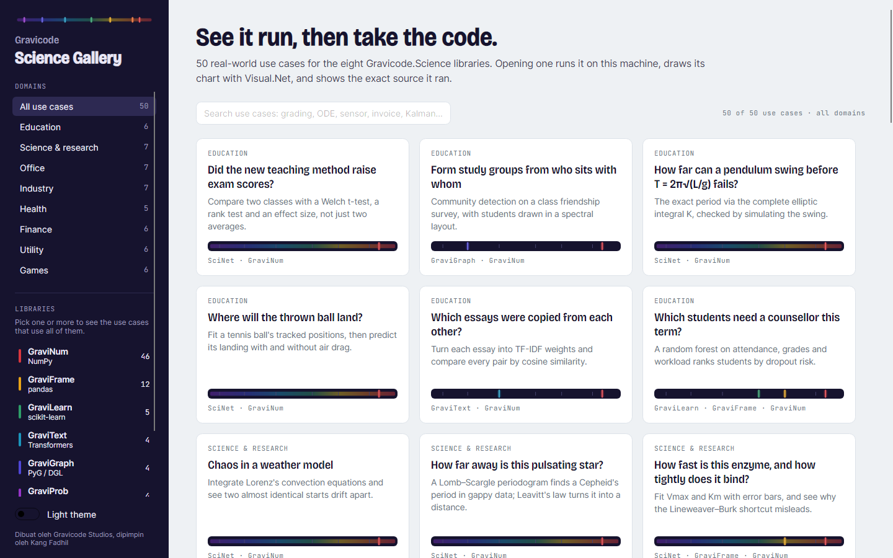
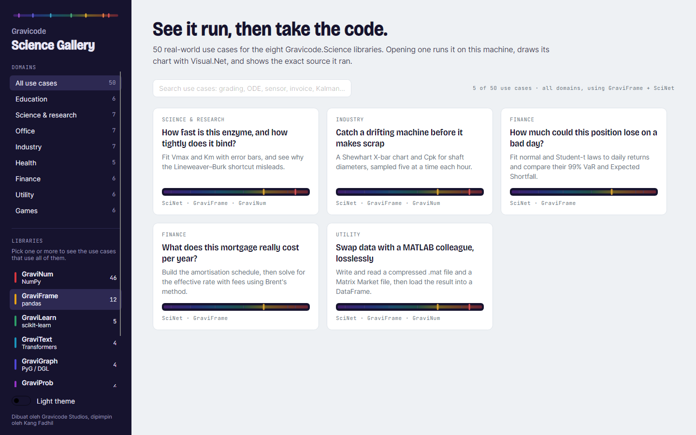
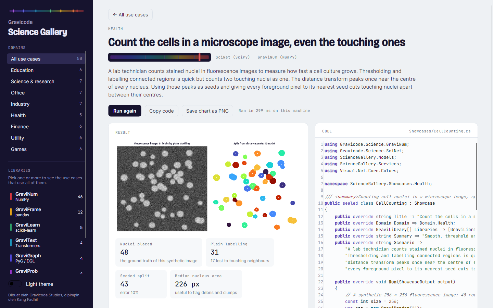
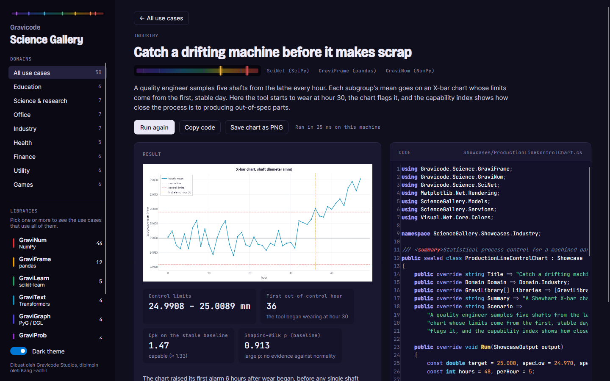
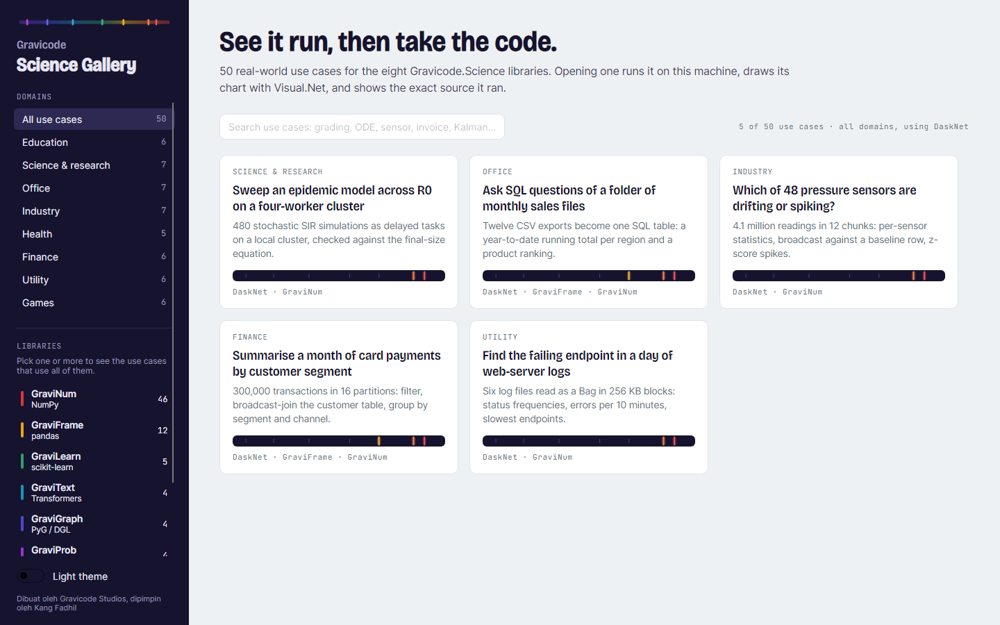
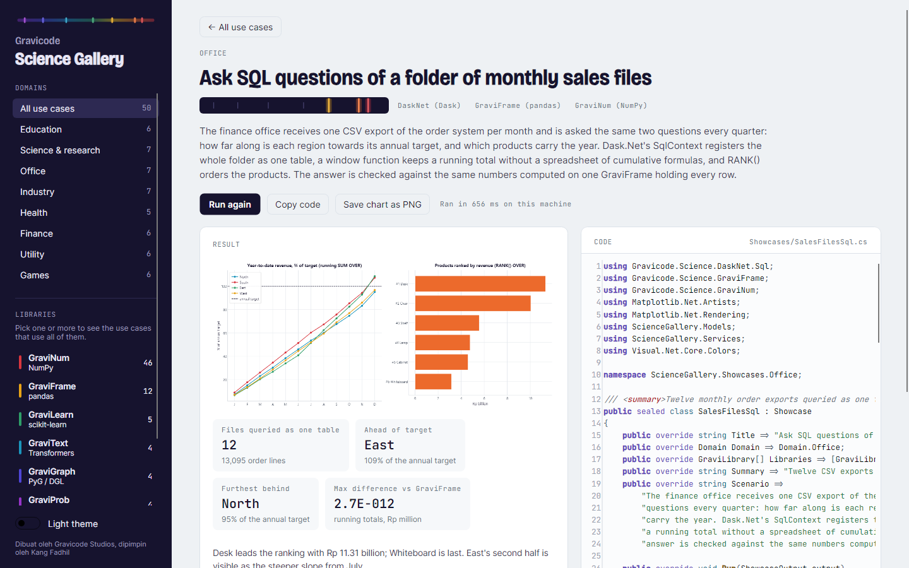
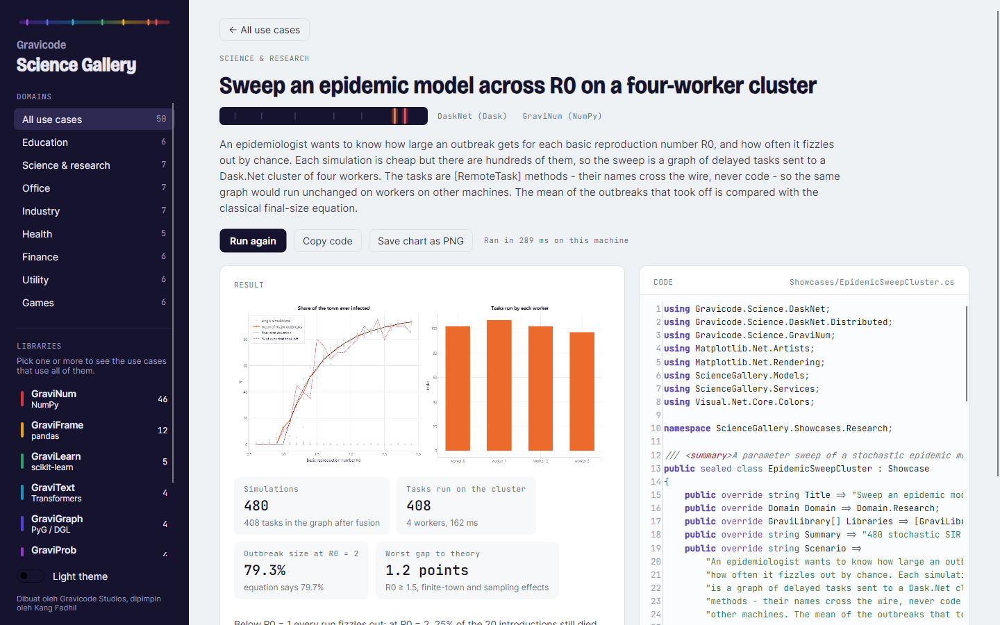
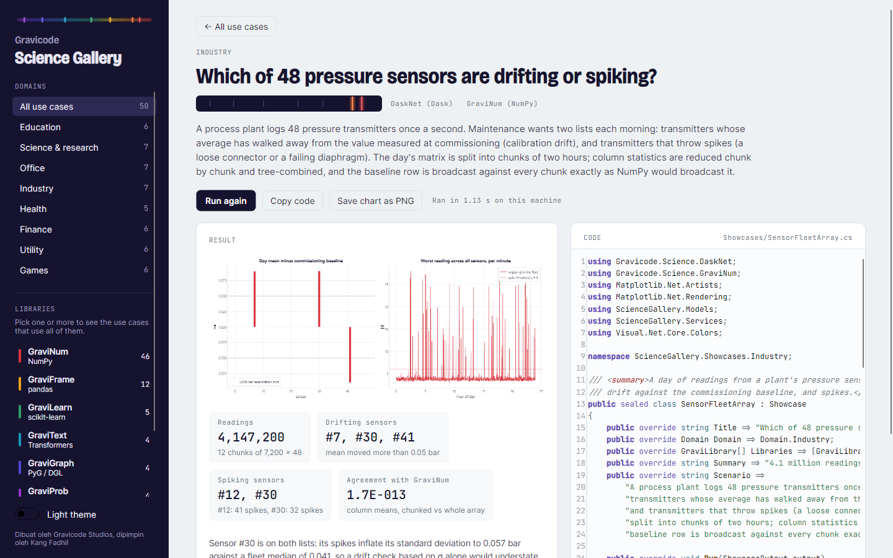

# Gravicode Science Gallery

*[Bahasa Indonesia](id/ScienceGallery.md)* · 50 real-world use cases for the eight
Gravicode.Science libraries — each one runs on your machine when you open it, draws its chart with
[Visual.Net](https://github.com/DotNetVibeCoderz/Vibe_Charting/tree/main/Visual.Net), and shows
the exact source file it ran.



```bash
dotnet run --project tools/ScienceGallery
```

The gallery is for finding a use case like yours, watching it work, and taking the code. It covers
education, science and research, office work, industry, health, finance, everyday utilities and
games, and every library appears in several of them.

## Finding a use case

- **Domains** in the sidebar narrow the grid to one field.
- **Libraries** filter by what a use case uses. Pick more than one and the grid shows only the use
  cases that use *all* of them — GraviFrame + SciNet, say, for data-wrangling-then-statistics.
- **Search** matches titles, summaries, scenarios, domains and library names: try *Kalman*,
  *invoice*, *ODE* or *grading*.



### The spectrum strip

Every card carries a strip that reads like a spectroscope. Each Gravi library is a real emission
line — the same colour and wavelength as its NuGet icon — and the lines a use case needs are lit,
the rest left as faint ticks. SciNet, the instrument rather than a line, lights the whole band
behind them. Dask.Net is the orange neon line at 640 nm, just short of GraviNum's red. The strip tells you at a glance what a use case needs before you open it.

## Opening one

Opening a card runs it immediately, off the UI thread, and shows three things side by side:

- **Result** — the chart (drawn by Matplotlib.Net), the key numbers with what they mean, and a
  sentence or two interpreting them. The numbers are computed by the run, not written into the text.
- **Code** — the showcase's own source file, embedded into the app at build time. What you read is
  what ran: there is no separate, tidied-up copy that could drift.
- **Actions** — *Run again*, *Copy code*, and *Save chart as PNG*. The status line says how long
  the run took on this machine.



The light theme is the default; the switch at the bottom of the sidebar turns on the dark one.



## The use cases

| Domain | Use case | Libraries |
|---|---|---|
| Education | Did the new teaching method raise exam scores? | SciNet, GraviNum |
| | Form study groups from who sits with whom | GraviGraph, GraviNum |
| | How far can a pendulum swing before T = 2π√(L/g) fails? | SciNet, GraviNum |
| | Where will the thrown ball land? | SciNet, GraviNum |
| | Which essays were copied from each other? | GraviText, GraviNum |
| | Which students need a counsellor this term? | GraviLearn, GraviFrame, GraviNum |
| Science & research | Chaos in a weather model | SciNet, GraviNum |
| | How far away is this pulsating star? | SciNet, GraviNum |
| | How fast is this enzyme, and how tightly does it bind? | SciNet, GraviFrame, GraviNum |
| | How much calcite is in this rock sample? | SciNet, GraviNum |
| | When will the outbreak peak, and how big will it be? | SciNet, GraviNum |
| | Which papers does the field actually build on? (Cora) | GraviGraph, SciNet, GraviNum |
| | Sweep an epidemic model across R0 on a four-worker cluster | DaskNet, GraviNum |
| Office | Turn a year of orders into the monthly sales report | GraviFrame, GraviNum |
| | Is a trained sentiment model worth the labelling? (IMDB reviews) | GraviText, GraviFrame, GraviLearn |
| | Pull the invoice number, vendor, date and amount out of emails | GraviText, GraviNum |
| | Sort a shared inbox into topics nobody labelled | GraviText, GraviLearn, GraviNum |
| | Fit ten meetings into ten rooms without anyone squeezing in | SciNet |
| | Build next week's rota that covers every shift and honours leave | SciNet, GraviNum |
| | Ask SQL questions of a folder of monthly sales files | DaskNet, GraviFrame, GraviNum |
| Industry | Catch a drifting machine before it makes scrap | SciNet, GraviFrame, GraviNum |
| | Which bearing race is cracking in this motor? | SciNet, GraviNum |
| | Walk less on every warehouse pick list | SciNet, GraviNum |
| | Which supplier could stop all three factories? | GraviGraph, GraviNum |
| | How much power will the building draw in the next 48 hours? | GraviProb, GraviFrame, GraviNum |
| | How warm can the coolant get before the reactor runs away? | SciNet, GraviNum |
| | Which of 48 pressure sensors are drifting or spiking? | DaskNet, GraviNum |
| Health | Heart rate and variability from a noisy ECG | SciNet, GraviNum |
| | Twice or three times a day: which schedule keeps the drug in range? | SciNet, GraviNum |
| | How sure are we that the new treatment works better? | GraviProb, SciNet, GraviNum |
| | Do patients stay relapse-free longer on the new therapy? | SciNet, GraviNum |
| | Count the cells in a microscope image, even the touching ones | SciNet, GraviNum |
| Finance | The best mix of five assets for each level of risk | SciNet, GraviNum |
| | What is this stock option worth today? | SciNet, GraviNum |
| | How much could this position lose on a bad day? | SciNet, GraviFrame |
| | Flag card payments that do not look like the cardholder | GraviLearn, GraviNum |
| | What does this mortgage really cost per year? | SciNet, GraviFrame |
| | Summarise a month of card payments by customer segment | DaskNet, GraviFrame, GraviNum |
| Utility | Clean the hum and whistle out of a recording | SciNet, GraviNum |
| | Rescue a grainy photo with dead pixels | SciNet, GraviNum |
| | Why does my running app say I ran further than I did? | GraviProb, SciNet, GraviNum |
| | Which store is nearest, and where should the next one open? | SciNet, GraviNum |
| | Swap data with a MATLAB colleague, losslessly | SciNet, GraviFrame, GraviNum |
| | Find the failing endpoint in a day of web-server logs | DaskNet, GraviNum |
| Games | Generate a believable island for a game map | SciNet, GraviNum |
| | Build a maze, solve it, and let every monster find the player | GraviGraph, GraviNum |
| | Does the game's bouncing ball lose the right amount of energy? | SciNet, GraviNum |
| | Are the matchmaker's win chances honest? | GraviLearn, GraviFrame, GraviNum |
| | What are the exact odds of this dice roll? | SciNet, GraviNum |
| | How long do players stay, and what is a new player worth? | GraviProb, SciNet, GraviNum |

### Dask.Net use cases

Five use cases show [Dask.Net](DaskNet.md), each on a different part of it. Filter by the Dask.Net
library to see them together:



| Use case | What of Dask.Net it shows |
|---|---|
| Ask SQL questions of a folder of monthly sales files | `SqlContext.RegisterCsv` over twelve files, a join, `SUM(SUM(x)) OVER (PARTITION BY ... ORDER BY ...)` running totals and `RANK() OVER`; checked against one GraviFrame to ~1e-12, with the optimised plan printed |
| Summarise a month of card payments by customer segment | `DaskFrame` with expression filters, a broadcast join, `GroupBy().Agg`; `Explain()` shows the filter pushed into the scan below the join |
| Sweep an epidemic model across R0 on a four-worker cluster | `Dask.Delayed` over `[RemoteTask]` methods on `LocalCluster.StartAsync`, with the tasks each worker ran |
| Which of 48 pressure sensors are drifting or spiking? | a 86,400 × 48 `DaskArray` in 12 chunks: axis reductions, broadcasting against a baseline row, z-scores |
| Find the failing endpoint in a day of web-server logs | `Bag.ReadText` in byte blocks, `Frequencies`, `FoldBy` and `TopK`, three answers from one pass |







The cluster use case is the only one that needs `[RemoteTask]` methods: a client sends a method's
name, never code, so a lambda in the graph is refused. `Dask.All` (gather) is a local delegate in
Dask.Net 2.2, so it is avoided there - a four-argument `[RemoteTask]` combines the batches instead.
The other four use the default thread scheduler, where lambdas are fine.

Some use cases say plainly where a method falls short, because that is what the result showed: on
80 IMDB reviews the trained sentiment classifier loses to the word list, both tickers in
`finance_timeseries.csv` turn out to be close to normal (so the Value-at-Risk text says so instead
of claiming fat tails), and the reactor ODE is not stiff, so BDF is not the faster solver there.

## How it is built

```
tools/ScienceGallery/
  Models/        Showcase (the contract every use case implements), libraries, domains
  Showcases/     one file per use case, by domain - these are what the code panel shows
  Services/      registry, chart style, dataset lookup, screenshot tour
  Controls/      SpectrumStrip
  ViewModels/    filtering, running, results
  Views/         the window
  Themes/        tokens (light and dark) and control styles
  Assets/Fonts/  Bricolage Grotesque and JetBrains Mono (SIL Open Font Licence)
```

### Adding a use case

Create a file under `Showcases/<Domain>/`, derive from `Showcase`, and fill in the title, domain,
libraries, summary, scenario and `Run`. The registry finds it by reflection and the build embeds
its source, so there is nothing to register:

```csharp
public sealed class MyUseCase : Showcase
{
    public override string Title => "A concrete question in plain words";
    public override Domain Domain => Domain.Research;
    public override GraviLibrary[] Libraries => [GraviLibrary.SciNet, GraviLibrary.GraviNum];
    public override string Summary => "One sentence for the card.";
    public override string Scenario => "Who does this, why, and what the result tells them.";

    public override void Run(ShowcaseOutput output)
    {
        var figure = GalleryCharts.Figure();
        var ax = figure.AddSubplot();
        // ... compute, plot ...
        output.Chart(figure);
        output.Metric("Key number", "42", "what it means");
        output.Line("One sentence interpreting the result.");
    }
}
```

The file is shown to users as the example to copy, so write it as teaching code: self-contained,
deterministic (seeded), commented where the reasoning is not obvious, and fast (well under 2 s).

### Visual.Net comes from NuGet

The charts use the `Gravicode.Matplotlib.Net` and `Gravicode.Seaborn.Net` packages (Visual.Net 1.1.0,
built from [Vibe_Charting](https://github.com/DotNetVibeCoderz/Vibe_Charting)). They depend on
`Gravicode.Science.GraviNum`, `GraviFrame` and `GraviLearn`; the gallery references those libraries
as projects with the same package ids, so NuGet resolves them to the local build and there is one
copy of each. Visual.Net renders with SkiaSharp 4, which arrives transitively and is deliberately
not pinned in `Directory.Packages.props` — transitive pinning would move the ScottPlot samples off
SkiaSharp 3.

### Command-line modes

| Command | What it does |
|---|---|
| `ScienceGallery --run-all` | Runs every use case headless and renders its chart; exits non-zero if any fails. CI runs this on Linux and Windows. Add `--only <text>` to run the use cases whose class name contains it, and `--verbose` to print their metrics and findings. |
| `ScienceGallery --capture <folder>` | Drives the real window through home, a domain, a filter, four use cases, the dark theme, the Dask.Net filter and three Dask.Net use cases, and saves each as a 1440×900 PNG. The screenshots on this page come from it. |

---

Dibuat oleh Gravicode Studios, dipimpin oleh Kang Fadhil.
