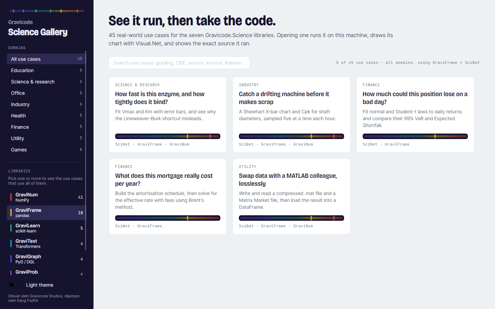
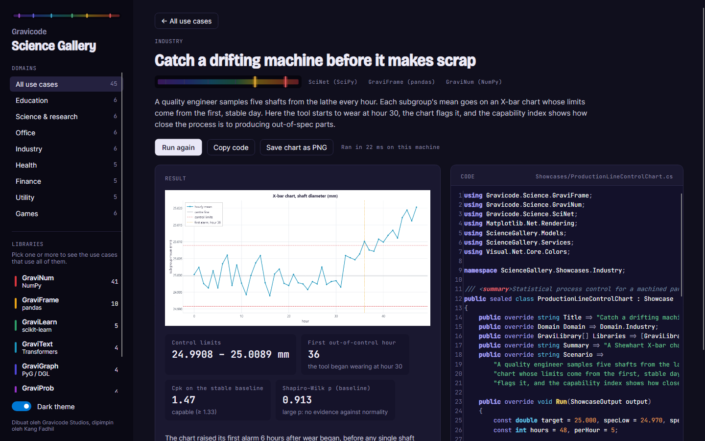

# Gravicode Science Gallery

*[Bahasa Indonesia](id/ScienceGallery.md)* · 45 real-world use cases for the seven
Gravicode.Science libraries — each one runs on your machine when you open it, draws its chart with
[Visual.Net](https://github.com/DotNetVibeCoderz/Vibe_Charting/tree/main/Visual.Net), and shows
the exact source file it ran.


```bash
dotnet run --project tools/ScienceGallery
```

The gallery is for finding a use case like yours, watching it work, and taking the code. It covers
education, science and research, office work, industry, health, finance, everyday utilities and
games, and every library appears in several of them.

## Finding a use case

- **Domains** in the sidebar narrow the grid to one field.
- **Libraries** filter by what a use case uses. Pick more than one and the grid shows only the use
  cases that use *all* of them — GraviFrame + SciNet, say, for data-wrangling-then-statistics.
- **Search** matches titles, summaries, scenarios, domains and library names: try *Kalman*,
  *invoice*, *ODE* or *grading*.



### The spectrum strip

Every card carries a strip that reads like a spectroscope. Each Gravi library is a real emission
line — the same colour and wavelength as its NuGet icon — and the lines a use case needs are lit,
the rest left as faint ticks. SciNet, the instrument rather than a line, lights the whole band
behind them. The strip tells you at a glance what a use case needs before you open it.

## Opening one

Opening a card runs it immediately, off the UI thread, and shows three things side by side:

- **Result** — the chart (drawn by Matplotlib.Net), the key numbers with what they mean, and a
  sentence or two interpreting them. The numbers are computed by the run, not written into the text.
- **Code** — the showcase's own source file, embedded into the app at build time. What you read is
  what ran: there is no separate, tidied-up copy that could drift.
- **Actions** — *Run again*, *Copy code*, and *Save chart as PNG*. The status line says how long
  the run took on this machine.


The light theme is the default; the switch at the bottom of the sidebar turns on the dark one.



## The use cases

| Domain | Use case | Libraries |
|---|---|---|
| Education | Did the new teaching method raise exam scores? | SciNet, GraviNum |
| | Form study groups from who sits with whom | GraviGraph, GraviNum |
| | How far can a pendulum swing before T = 2π√(L/g) fails? | SciNet, GraviNum |
| | Where will the thrown ball land? | SciNet, GraviNum |
| | Which essays were copied from each other? | GraviText, GraviNum |
| | Which students need a counsellor this term? | GraviLearn, GraviFrame, GraviNum |
| Science & research | Chaos in a weather model | SciNet, GraviNum |
| | How far away is this pulsating star? | SciNet, GraviNum |
| | How fast is this enzyme, and how tightly does it bind? | SciNet, GraviFrame, GraviNum |
| | How much calcite is in this rock sample? | SciNet, GraviNum |
| | When will the outbreak peak, and how big will it be? | SciNet, GraviNum |
| | Which papers does the field actually build on? (Cora) | GraviGraph, SciNet, GraviNum |
| Office | Turn a year of orders into the monthly sales report | GraviFrame, GraviNum |
| | Is a trained sentiment model worth the labelling? (IMDB reviews) | GraviText, GraviFrame, GraviLearn |
| | Pull the invoice number, vendor, date and amount out of emails | GraviText, GraviNum |
| | Sort a shared inbox into topics nobody labelled | GraviText, GraviLearn, GraviNum |
| | Fit ten meetings into ten rooms without anyone squeezing in | SciNet |
| | Build next week's rota that covers every shift and honours leave | SciNet, GraviNum |
| Industry | Catch a drifting machine before it makes scrap | SciNet, GraviFrame, GraviNum |
| | Which bearing race is cracking in this motor? | SciNet, GraviNum |
| | Walk less on every warehouse pick list | SciNet, GraviNum |
| | Which supplier could stop all three factories? | GraviGraph, GraviNum |
| | How much power will the building draw in the next 48 hours? | GraviProb, GraviFrame, GraviNum |
| | How warm can the coolant get before the reactor runs away? | SciNet, GraviNum |
| Health | Heart rate and variability from a noisy ECG | SciNet, GraviNum |
| | Twice or three times a day: which schedule keeps the drug in range? | SciNet, GraviNum |
| | How sure are we that the new treatment works better? | GraviProb, SciNet, GraviNum |
| | Do patients stay relapse-free longer on the new therapy? | SciNet, GraviNum |
| | Count the cells in a microscope image, even the touching ones | SciNet, GraviNum |
| Finance | The best mix of five assets for each level of risk | SciNet, GraviNum |
| | What is this stock option worth today? | SciNet, GraviNum |
| | How much could this position lose on a bad day? | SciNet, GraviFrame |
| | Flag card payments that do not look like the cardholder | GraviLearn, GraviNum |
| | What does this mortgage really cost per year? | SciNet, GraviFrame |
| Utility | Clean the hum and whistle out of a recording | SciNet, GraviNum |
| | Rescue a grainy photo with dead pixels | SciNet, GraviNum |
| | Why does my running app say I ran further than I did? | GraviProb, SciNet, GraviNum |
| | Which store is nearest, and where should the next one open? | SciNet, GraviNum |
| | Swap data with a MATLAB colleague, losslessly | SciNet, GraviFrame, GraviNum |
| Games | Generate a believable island for a game map | SciNet, GraviNum |
| | Build a maze, solve it, and let every monster find the player | GraviGraph, GraviNum |
| | Does the game's bouncing ball lose the right amount of energy? | SciNet, GraviNum |
| | Are the matchmaker's win chances honest? | GraviLearn, GraviFrame, GraviNum |
| | What are the exact odds of this dice roll? | SciNet, GraviNum |
| | How long do players stay, and what is a new player worth? | GraviProb, SciNet, GraviNum |

Some use cases say plainly where a method falls short, because that is what the result showed: on
80 IMDB reviews the trained sentiment classifier loses to the word list, both tickers in
`finance_timeseries.csv` turn out to be close to normal (so the Value-at-Risk text says so instead
of claiming fat tails), and the reactor ODE is not stiff, so BDF is not the faster solver there.

## How it is built

```
tools/ScienceGallery/
  Models/        Showcase (the contract every use case implements), libraries, domains
  Showcases/     one file per use case, by domain - these are what the code panel shows
  Services/      registry, chart style, dataset lookup, screenshot tour
  Controls/      SpectrumStrip
  ViewModels/    filtering, running, results
  Views/         the window
  Themes/        tokens (light and dark) and control styles
  VisualNet/     wrapper projects that compile Visual.Net from its own repository
  Assets/Fonts/  Bricolage Grotesque and JetBrains Mono (SIL Open Font Licence)
```

### Adding a use case

Create a file under `Showcases/<Domain>/`, derive from `Showcase`, and fill in the title, domain,
libraries, summary, scenario and `Run`. The registry finds it by reflection and the build embeds
its source, so there is nothing to register:

```csharp
public sealed class MyUseCase : Showcase
{
    public override string Title => "A concrete question in plain words";
    public override Domain Domain => Domain.Research;
    public override GraviLibrary[] Libraries => [GraviLibrary.SciNet, GraviLibrary.GraviNum];
    public override string Summary => "One sentence for the card.";
    public override string Scenario => "Who does this, why, and what the result tells them.";

    public override void Run(ShowcaseOutput output)
    {
        var figure = GalleryCharts.Figure();
        var ax = figure.AddSubplot();
        // ... compute, plot ...
        output.Chart(figure);
        output.Metric("Key number", "42", "what it means");
        output.Line("One sentence interpreting the result.");
    }
}
```

The file is shown to users as the example to copy, so write it as teaching code: self-contained,
deterministic (seeded), commented where the reasoning is not obvious, and fast (well under 2 s).

### Visual.Net comes from its own repository

Visual.Net is not on NuGet and carries an older snapshot of GraviNum/GraviFrame/GraviLearn under the
same assembly names. The projects in `VisualNet/` therefore compile only its chart libraries
(Visual.Net.Core, Matplotlib.Net, Seaborn.Net) from a checkout of
[Vibe_Charting](https://github.com/DotNetVibeCoderz/Vibe_Charting) and link them to this repository's
Gravicode.Science projects — one copy of each library, and no code copied between repositories.
The sources are found through the `VISUALNET_ROOT` environment variable, or a `Vibe_Charting` checkout
next to the `Vibe_ML` one:

```
VibeCoding/
  Vibe_ML/GravicodeScience/...
  Vibe_Charting/Visual.Net/src/...
```

CI checks out `Visual.Net/src` sparsely and sets `VISUALNET_ROOT`. Visual.Net renders with SkiaSharp
4, which is referenced only by these wrapper projects so that central transitive pinning does not move
the ScottPlot samples off SkiaSharp 3.

### Command-line modes

| Command | What it does |
|---|---|
| `ScienceGallery --run-all` | Runs every use case headless and renders its chart; exits non-zero if any fails. CI runs this on Linux and Windows. |
| `ScienceGallery --capture <folder>` | Drives the real window through home, a domain, a filter, four use cases and the dark theme, and saves each as a 1440×900 PNG. The screenshots on this page come from it. |

---

Dibuat oleh Gravicode Studios, dipimpin oleh Kang Fadhil.
